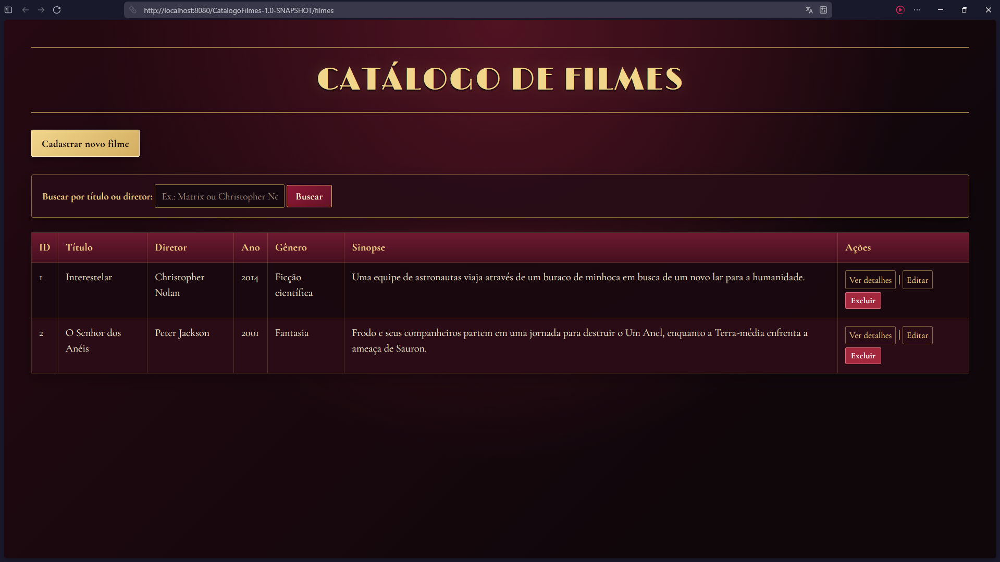
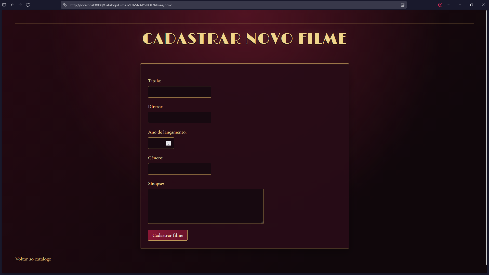
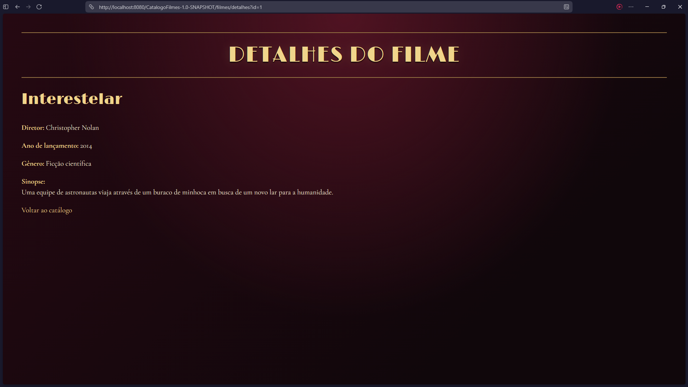
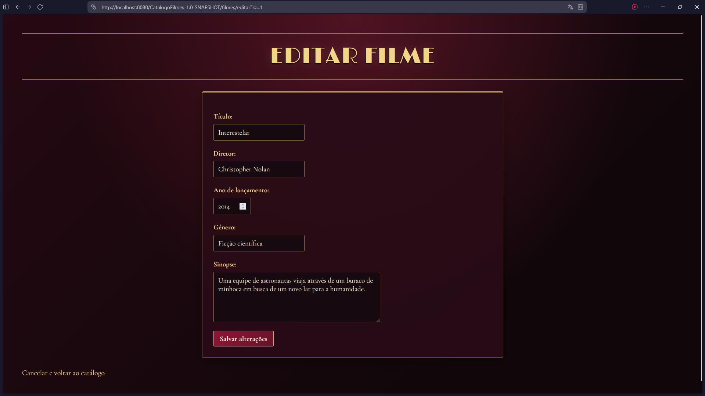
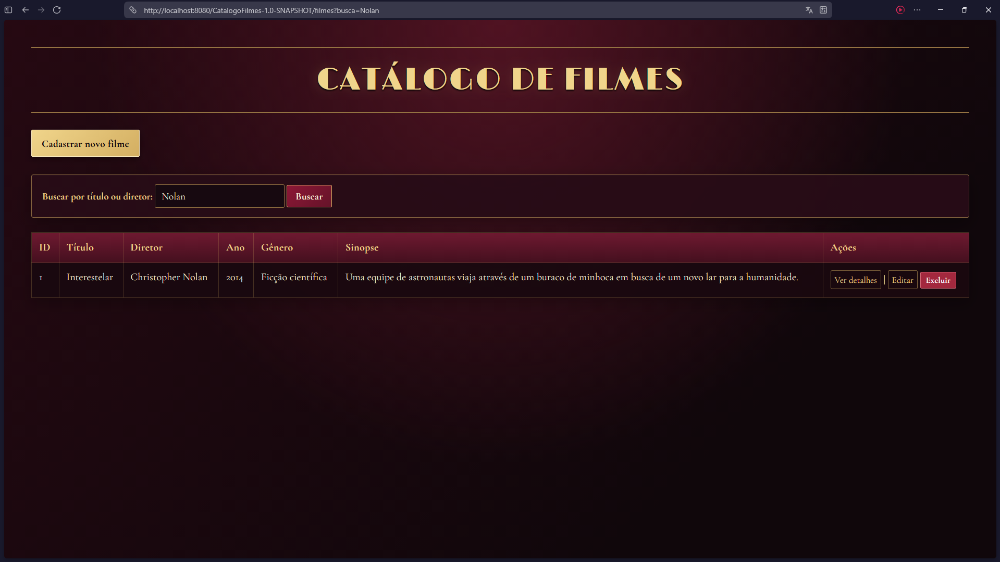

# Relatório Técnico — Catálogo de Filmes

## 1. Introdução

O presente relatório descreve o desenvolvimento do Catálogo de Filmes, uma aplicação web criada como projeto acadêmico no contexto do curso de Ciência da Computação. O sistema permite cadastrar, consultar, pesquisar, editar e excluir informações sobre filmes, mantendo os dados armazenados em um banco de dados relacional.

O projeto foi desenvolvido com a linguagem Java, utilizando o paradigma de Programação Orientada a Objetos (POO). A interface web foi construída com JavaServer Pages (JSP), enquanto Servlets são responsáveis pelo processamento das requisições HTTP e pela comunicação entre a interface e a camada de acesso a dados.

Para a persistência das informações, foi utilizado o MySQL, acessado por meio de JDBC. A aplicação foi executada em um servidor Apache Tomcat, utilizando Maven para o gerenciamento das dependências e a compilação do projeto.

O desenvolvimento teve como foco a aplicação prática dos conceitos estudados durante a formação acadêmica, incluindo organização em classes, encapsulamento, persistência de dados, validação de entradas, tratamento de exceções e desenvolvimento de interfaces web.

## 2. Objetivos

### 2.1. Objetivo geral

Desenvolver uma aplicação web para catalogação e consulta de filmes, aplicando os princípios da Programação Orientada a Objetos em Java e utilizando um banco de dados relacional para a persistência das informações.

### 2.2. Objetivos específicos

- Implementar uma interface web para navegação e gerenciamento do catálogo.
- Permitir o cadastro de filmes com título, diretor, ano de lançamento, gênero e sinopse.
- Exibir a lista de filmes cadastrados e permitir a consulta dos detalhes de um registro específico.
- Implementar funcionalidades para edição e exclusão de filmes.
- Disponibilizar uma busca simples por título ou diretor.
- Persistir os registros em um banco de dados MySQL por meio de JDBC.
- Organizar o código em classes com responsabilidades distintas, incluindo modelo, acesso a dados e controladores web.
- Aplicar validações nos dados recebidos e medidas básicas de segurança durante o processamento e a exibição das informações.
- Executar testes funcionais e de segurança para verificar o comportamento da aplicação.

## 3. Delimitação do escopo

Para manter o projeto compatível com o cronograma acadêmico, o sistema foi limitado ao gerenciamento de filmes. Cada registro contém um identificador, título, diretor, ano de lançamento, gênero e sinopse.

O escopo contempla as operações essenciais de cadastro, listagem, consulta de detalhes, edição, exclusão e busca, além da persistência dos dados e da validação das entradas recebidas pela aplicação.

Funcionalidades opcionais, como avaliações, upload de capas e filtragem por gênero, não foram incluídas nesta versão, pois não fazem parte dos requisitos essenciais selecionados para o projeto.

## 4. Metodologia

O desenvolvimento foi conduzido de maneira iterativa, com a implementação e a verificação das funcionalidades em etapas sucessivas. Essa abordagem permitiu evoluir o sistema progressivamente, validando cada parte antes de avançar para a seguinte.

Inicialmente, foram definidos o escopo e os atributos dos filmes. Em seguida, foi implementada a estrutura de classes Java e a conexão com o banco de dados. A camada de persistência foi desenvolvida para encapsular as operações SQL, enquanto os Servlets foram implementados para processar as requisições da aplicação web.

As páginas JSP foram construídas para disponibilizar os formulários e apresentar os registros recuperados do banco. Após a implementação das funcionalidades principais, foram realizados testes manuais de cadastro, consulta, busca, edição e exclusão, além de verificações de validação de entradas e de comportamentos relacionados à segurança.

Os problemas encontrados durante os testes foram corrigidos de forma incremental. Posteriormente, foram realizados ajustes no tratamento de erros, na configuração das credenciais de acesso ao banco e na apresentação visual da aplicação.

### 4.1. Tecnologias e ferramentas utilizadas

| Tecnologia ou ferramenta | Finalidade |
|---|---|
| Java 21 | Implementação da lógica da aplicação e das classes orientadas a objetos. |
| Apache Maven | Gerenciamento de dependências e processo de compilação. |
| MySQL | Armazenamento persistente dos dados do catálogo. |
| JDBC | Comunicação entre a aplicação Java e o banco de dados. |
| Apache Tomcat 10.1 | Servidor responsável pela execução da aplicação web. |
| Jakarta Servlets | Processamento das requisições HTTP e controle do fluxo da aplicação. |
| JSP e JSTL | Construção das páginas web e apresentação dos dados. |
| HTML | Estruturação dos formulários e das páginas. |
| CSS | Definição da apresentação visual da interface. |
| Git e GitHub | Versionamento do código-fonte e armazenamento remoto do projeto. |

O projeto também utiliza o MySQL Workbench para administração e inspeção do banco de dados e o IntelliJ IDEA como ambiente de desenvolvimento.

## 5. Modelagem do sistema

A modelagem do Catálogo de Filmes foi elaborada para representar o comportamento esperado da aplicação, a organização de suas classes e a estrutura dos dados armazenados. Foram utilizados diagramas UML para descrever as interações do usuário e as dependências entre os componentes, além de um modelo de dados para representar a tabela principal do banco de dados.

Os arquivos-fonte dos diagramas foram desenvolvidos em PlantUML e estão disponíveis no diretório `docs/diagramas/` do projeto.

### 5.1. Diagrama de casos de uso

O diagrama de casos de uso representa as principais interações entre o usuário e o sistema. Foi definido um único ator, denominado Usuário, que pode realizar as operações de listar filmes, buscar por título ou diretor, visualizar detalhes, cadastrar, editar e excluir registros.

A representação evidencia o conjunto de funcionalidades disponibilizadas pela aplicação, delimitando seu escopo de acordo com os requisitos obrigatórios do projeto.

**Arquivo-fonte:** `docs/diagramas/casos-de-uso.puml`.

### 5.2. Diagrama de classes

O diagrama de classes apresenta uma visão simplificada da estrutura estática da aplicação e das dependências entre seus componentes principais.

A classe `Filme`, pertencente ao pacote `org.example.model`, representa a entidade central do domínio. Ela mantém os atributos de identificação e descrição dos filmes e fornece métodos de acesso e modificação desses dados.

A classe `FilmeDAO`, localizada no pacote `org.example.database`, encapsula as operações de persistência realizadas por meio de JDBC. Ela implementa os métodos de listagem, busca por identificador, busca por título ou diretor, cadastro, atualização e exclusão.

A classe `Conexao` centraliza a configuração e o estabelecimento da conexão com o MySQL. A senha utilizada na conexão é obtida por meio da variável de ambiente `CATALOGO_DB_PASSWORD`.

No pacote `org.example.servlet`, os controladores recebem as requisições HTTP e coordenam as operações do sistema. O `FilmeServlet` trata a listagem e a busca; o `CadastroFilmeServlet` trata o cadastro; o `DetalhesFilmeServlet` consulta os dados de um filme específico; o `EditarFilmeServlet` gerencia a abertura e o salvamento do formulário de edição; e o `ExcluirFilmeServlet` processa a exclusão.

Essa divisão de responsabilidades facilita a compreensão e a manutenção do sistema, mantendo a apresentação, o controle das requisições, a representação dos dados e o acesso ao banco organizados em componentes distintos.

**Arquivo-fonte:** `docs/diagramas/diagrama-de-classes.puml`.

### 5.3. Modelo de dados

O modelo de dados foi definido para atender às necessidades do catálogo sem introduzir estruturas desnecessárias ao escopo escolhido. O banco de dados `catalogo_filmes` possui uma tabela principal denominada `filmes`.

A tabela utiliza a coluna `id` como chave primária, com incremento automático. As colunas `titulo`, `diretor`, `ano_lancamento` e `genero` são obrigatórias. A coluna `sinopse` é textual e permite valor nulo no banco de dados, embora a aplicação armazene uma string vazia quando a sinopse não é fornecida.

A tabela não possui relacionamentos com outras tabelas nesta versão do sistema. Essa estrutura é suficiente para representar os dados exigidos pelo projeto e sustentar as operações de cadastro, consulta, atualização, exclusão e busca.

O script `sql/schema.sql` contém os comandos para criação do banco e da tabela, permitindo reproduzir a estrutura em outra instalação do MySQL.

**Arquivo-fonte do DER:** `docs/diagramas/der.puml`.

**Script SQL:** `sql/schema.sql`.

## 6. Desenvolvimento e implementação

### 6.1. Arquitetura geral da aplicação

A aplicação foi estruturada em componentes com responsabilidades distintas, organizados em uma arquitetura de apresentação, controle e acesso a dados.

A camada de apresentação é composta pelas páginas JSP, responsáveis por exibir o catálogo, os formulários de cadastro e edição e os detalhes dos filmes. A JSTL e a Expression Language (EL) são utilizadas para apresentar os dados enviados pelos controladores.

A camada de controle é implementada por Servlets, que recebem as requisições HTTP, validam os parâmetros recebidos, invocam os métodos necessários do DAO e definem a resposta da aplicação.

A camada de acesso a dados é representada pela classe `FilmeDAO`, responsável pelas instruções SQL executadas por meio de JDBC. A classe `Conexao` centraliza a abertura das conexões com o MySQL, enquanto a classe `Filme` representa os dados manipulados pelas demais camadas.

Essa organização evita concentrar toda a lógica em uma única classe e facilita a manutenção e a evolução do código.

### 6.2. Fluxo de uma requisição

O fluxo geral de funcionamento pode ser descrito pelas seguintes etapas:

1. O usuário acessa uma página ou envia um formulário pelo navegador.
2. A requisição HTTP é recebida pelo Servlet correspondente à rota solicitada.
3. O Servlet verifica os parâmetros recebidos e aplica as validações necessárias.
4. Quando é necessário consultar ou modificar registros, o Servlet utiliza a classe `FilmeDAO`.
5. O DAO executa as operações SQL no MySQL utilizando JDBC e retorna os resultados à camada de controle.
6. O Servlet encaminha os dados para uma página JSP ou redireciona o navegador para outra rota, conforme o resultado da operação.

Nas operações de leitura, os dados consultados são disponibilizados à JSP por meio de atributos da requisição. Nas operações de escrita, a aplicação verifica o resultado da operação antes de redirecionar o usuário ou informar uma falha.

### 6.3. Implementação do cadastro de filmes

O cadastro é realizado pelo `CadastroFilmeServlet`, que disponibiliza o formulário de entrada por meio da página `cadastro.jsp` e processa os dados enviados pelo usuário por uma requisição HTTP POST.

O Servlet verifica se os campos obrigatórios foram preenchidos, converte o ano de lançamento para um número inteiro e confirma se ele está dentro do intervalo permitido pela aplicação, de 1800 a 2100. Também verifica os limites de tamanho dos campos de texto antes de construir o objeto `Filme`.

Depois da validação, o objeto é encaminhado ao método `adicionarFilme()` da classe `FilmeDAO`. Esse método utiliza um `PreparedStatement` para executar a instrução SQL de inserção no banco.

O resultado da operação é utilizado pelo Servlet para decidir o próximo passo: quando o cadastro é concluído, o usuário é redirecionado ao catálogo; quando ocorre uma falha de banco de dados, a exceção é registrada no log do servidor e é apresentada uma mensagem genérica de erro.

Esse fluxo exemplifica a integração entre formulário web, controle da requisição, validação, representação do domínio e persistência dos dados.

### 6.4. Implementação da busca de filmes

A funcionalidade de busca permite localizar registros por correspondências parciais no título ou no diretor.

A interface envia o termo informado pelo usuário ao `FilmeServlet` por meio de uma requisição GET, utilizando o parâmetro `busca`. Quando o parâmetro contém um termo não vazio, o controlador chama o método `buscar()` do DAO; caso contrário, solicita a listagem completa por meio de `listarFilmes()`.

O método `buscar()` executa uma consulta SQL que utiliza as condições `LIKE` para procurar o termo nas colunas `titulo` e `diretor`. Os valores são fornecidos por parâmetros de um `PreparedStatement`, evitando a incorporação direta do texto informado pelo usuário à instrução SQL.

Os resultados são enviados à `index.jsp`, que percorre a lista de filmes e apresenta os registros encontrados. Quando não há correspondências, a página informa que nenhum filme foi encontrado para o termo pesquisado. Quando o campo de busca está vazio e o banco não retorna registros, a mensagem apresentada é diferente, indicando que não há filmes cadastrados.

### 6.5. Demais funcionalidades implementadas

A listagem utiliza o `FilmeServlet` para recuperar os registros armazenados no banco e apresentá-los na página principal. A visualização de detalhes é realizada pelo `DetalhesFilmeServlet`, que consulta um filme pelo identificador e disponibiliza seus atributos à página `detalhes.jsp`.

A edição é controlada pelo `EditarFilmeServlet`. O método GET recupera os dados do filme e abre um formulário preenchido com os valores atuais. O método POST valida os dados recebidos e encaminha o objeto ao método `atualizarFilme()` do DAO, que executa a operação SQL de atualização.

A exclusão é processada pelo `ExcluirFilmeServlet`, que recebe o identificador por uma requisição POST. Antes do envio, a interface solicita confirmação ao usuário. O controlador valida o identificador e utiliza o DAO para executar a exclusão do registro correspondente.

Essas funcionalidades completam as operações essenciais do catálogo e permitem o gerenciamento dos registros por meio da interface web.

### 6.6. Validação e tratamento de erros

As entradas recebidas dos formulários são validadas no servidor antes da execução das operações de escrita. Entre as verificações implementadas estão o preenchimento dos campos obrigatórios, a conversão numérica do identificador e do ano, o intervalo permitido para o ano de lançamento e os limites de tamanho dos campos textuais.

A aplicação também trata situações como identificadores inválidos, filmes inexistentes e falhas em operações de banco de dados. Nas consultas e operações em que as exceções SQL são propagadas ao controlador, os erros são registrados no log do Tomcat, enquanto o usuário recebe mensagens apropriadas ao contexto da requisição.

Essa separação entre as mensagens destinadas ao usuário e os detalhes registrados no servidor facilita o diagnóstico de falhas sem expor desnecessariamente informações internas do banco de dados.

## 7. Resultados e testes

A aplicação foi executada localmente no Apache Tomcat e integrada ao banco de dados MySQL. Durante o desenvolvimento, foram realizados testes manuais para verificar o funcionamento das operações de cadastro, listagem, consulta de detalhes, edição, exclusão e busca.

Os testes confirmaram que os registros cadastrados são persistidos no banco de dados e permanecem disponíveis após novas consultas. Também foi verificado que as alterações realizadas por meio do formulário de edição permanecem salvas quando o formulário é aberto novamente. A exclusão de registros de teste foi confirmada pela remoção dos itens do catálogo e pelas mensagens observadas no servidor.

Na funcionalidade de busca, foram verificadas consultas por partes do título e do nome do diretor, além de buscas sem correspondências e do envio de um termo vazio. Os resultados observados foram compatíveis com o comportamento esperado.

Também foram realizados testes específicos de validação. Um ano fora do intervalo permitido foi rejeitado pela aplicação. Para verificar a validação de tamanho no servidor, o limite HTML do título foi removido temporariamente pelas ferramentas de desenvolvimento do navegador. Um título com mais de 255 caracteres foi então enviado e rejeitado com a resposta HTTP 400, sem ser cadastrado.

A compilação do projeto foi verificada com as etapas `clean` e `package` do Maven, que finalizaram com o resultado `BUILD SUCCESS`. Após a publicação do arquivo WAR no Tomcat, as funcionalidades principais foram testadas novamente pelo navegador.

### 7.1. Registro dos testes

Os casos de teste, os procedimentos utilizados e os resultados observados estão documentados no arquivo `docs/testes/casos-de-teste.md`.

Os testes foram realizados manualmente durante o desenvolvimento. Não foram implementados testes unitários automatizados com JUnit nesta versão.

###  7.2. Evidências visuais

As capturas de tela a seguir demonstram as principais funcionalidades da aplicação em execução no navegador, utilizando a interface visual desenvolvida para o projeto.

**Figura 1 — Catálogo principal.** Apresenta a listagem dos filmes cadastrados, o campo de busca e as ações disponíveis para cada registro.

**Figura 2 — Formulário de cadastro.** Demonstra os campos disponíveis para cadastrar um novo filme.

**Figura 3 — Detalhes de um filme.** Apresenta as informações de um filme selecionado, incluindo título, diretor, ano de lançamento, gênero e sinopse.

**Figura 4 — Formulário de edição.** Demonstra o formulário preenchido com os dados existentes de um filme, permitindo sua alteração.

**Figura 5 — Resultado da busca.** Demonstra a pesquisa por parte do título, apresentando o registro correspondente ao termo informado.

## 8. Considerações sobre segurança

A implementação considerou medidas básicas de segurança relacionadas à entrada de dados, à execução de consultas SQL, à exibição de conteúdo fornecido pelo usuário e ao acesso ao banco de dados.

### 8.1. Prevenção contra SQL Injection

As consultas parametrizadas são executadas com `PreparedStatement`, mantendo os valores informados pelo usuário separados da instrução SQL. Essa abordagem foi aplicada às operações de consulta por identificador, busca textual, cadastro, atualização e exclusão.

Como teste manual, foi realizada uma busca pelo texto `' OR 1=1 --`. A aplicação não retornou todos os filmes cadastrados e tratou a entrada como um termo de pesquisa, conforme esperado.

### 8.2. Prevenção contra Cross-Site Scripting (XSS)

As páginas JSP utilizam a tag JSTL `<c:out>` para exibir dados fornecidos pelo usuário, escapando caracteres especiais na saída HTML.

No teste realizado, o título `` foi exibido literalmente no catálogo, sem execução de JavaScript ou abertura de um alerta no navegador. O registro temporário foi excluído após o teste.

Esse resultado demonstra o comportamento esperado no campo e na tela testados, mas não constitui uma auditoria completa de todas as possíveis vulnerabilidades de XSS.

### 8.3. Validação dos dados

Os Servlets verificam o preenchimento dos campos obrigatórios, a validade numérica do identificador e do ano de lançamento, o intervalo permitido para o ano e os limites de tamanho dos campos textuais.

As validações são executadas no servidor, sem depender exclusivamente das restrições aplicadas pelo HTML. Isso foi demonstrado pelo teste que removeu o limite do campo de título no navegador e enviou um valor superior ao permitido.

### 8.4. Proteção das credenciais e privilégios do banco

A senha utilizada na conexão com o MySQL é obtida por meio da variável de ambiente `CATALOGO_DB_PASSWORD`, em vez de ser armazenada diretamente no código-fonte.

Além disso, a aplicação utiliza o usuário dedicado `catalogo_app`, que recebeu apenas as permissões necessárias de `SELECT`, `INSERT`, `UPDATE` e `DELETE` no banco `catalogo_filmes`. O usuário não recebeu privilégios administrativos equivalentes aos de `root`.

Essa configuração reduz a exposição de credenciais no repositório e limita os privilégios disponíveis para a aplicação.

### 8.5. Tratamento de erros e limitações

As operações de banco de dados que propagam exceções SQL aos controladores registram detalhes técnicos no log do Tomcat, enquanto a resposta apresentada ao usuário utiliza mensagens genéricas para falhas internas.

Apesar dessas medidas, a aplicação não possui proteção específica contra CSRF nesta versão, nem passou por uma auditoria abrangente de segurança. Essas limitações devem ser consideradas caso o sistema seja ampliado ou disponibilizado em um ambiente público.

As medidas implementadas são adequadas como práticas básicas para um projeto acadêmico de escopo reduzido, mas não devem ser interpretadas como garantia de segurança completa.

## 9. Conclusões

O desenvolvimento do Catálogo de Filmes permitiu aplicar, em um projeto prático, conceitos de Programação Orientada a Objetos em Java, desenvolvimento web, acesso a bancos de dados relacionais e organização de software em componentes com responsabilidades distintas.

A aplicação implementa as funcionalidades essenciais estabelecidas no escopo: cadastro, listagem, consulta de detalhes, edição, exclusão e busca por título ou diretor. A integração entre Java, Servlets, JSP, JDBC e MySQL permitiu construir um sistema funcional, com persistência dos dados e acesso por meio de um navegador.

Durante o desenvolvimento, algumas etapas exigiram atenção especial, como a configuração do ambiente de execução, a integração entre as camadas da aplicação, o tratamento das exceções SQL e a configuração segura das credenciais de acesso ao banco. A implementação incremental facilitou a identificação e a correção dos problemas encontrados, permitindo validar as funcionalidades progressivamente.

Os testes manuais realizados demonstraram o funcionamento das operações principais, a persistência das alterações e o comportamento esperado em cenários específicos de validação e segurança. Também foram aplicadas medidas básicas de proteção, como o uso de consultas parametrizadas, o escape de conteúdo HTML exibido nas páginas JSP e a utilização de um usuário de banco com privilégios limitados.

Como aprendizado, o projeto reforçou a importância da separação de responsabilidades, da validação dos dados no servidor, do tratamento adequado de erros e da documentação ao longo do ciclo de desenvolvimento. O uso do Git e do GitHub também permitiu manter um histórico de versões e disponibilizar o código-fonte de forma organizada.

Conclui-se que o objetivo de desenvolver uma aplicação web para catalogar e consultar filmes foi alcançado dentro do escopo definido. Como possibilidades de evolução futura, poderão ser consideradas funcionalidades opcionais, como avaliações, associação de imagens de capa e filtros por gênero. Essas extensões não fazem parte da versão documentada neste relatório.

## 10. Referências

APACHE SOFTWARE FOUNDATION. **Apache Maven: Introduction to Maven**. Disponível em: https://maven.apache.org/what-is-maven. Acesso em: 9 out. 2026.

APACHE SOFTWARE FOUNDATION. **Apache Tomcat 10.1 Documentation**. Disponível em: https://tomcat.apache.org/tomcat-10.1-doc/. Acesso em: 9 out. 2026.

MYSQL. **MySQL Reference Manual: Prepared Statements**. Disponível em: https://dev.mysql.com/doc/refman/8.4/en/sql-prepared-statements.html. Acesso em: 9 out. 2026.

ORACLE. **Java Platform, Standard Edition 21 Documentation**. Disponível em: https://docs.oracle.com/en/java/javase/21/docs/. Acesso em: 9 out. 2026.

OWASP FOUNDATION. **Cross Site Scripting Prevention Cheat Sheet**. Disponível em: https://cheatsheetseries.owasp.org/cheatsheets/Cross_Site_Scripting_Prevention_Cheat_Sheet.html. Acesso em: 9 out. 2026.

PLANTUML. **PlantUML: Language Reference Guide**. Disponível em: https://plantuml.com/guide. Acesso em: 9 out. 2026.